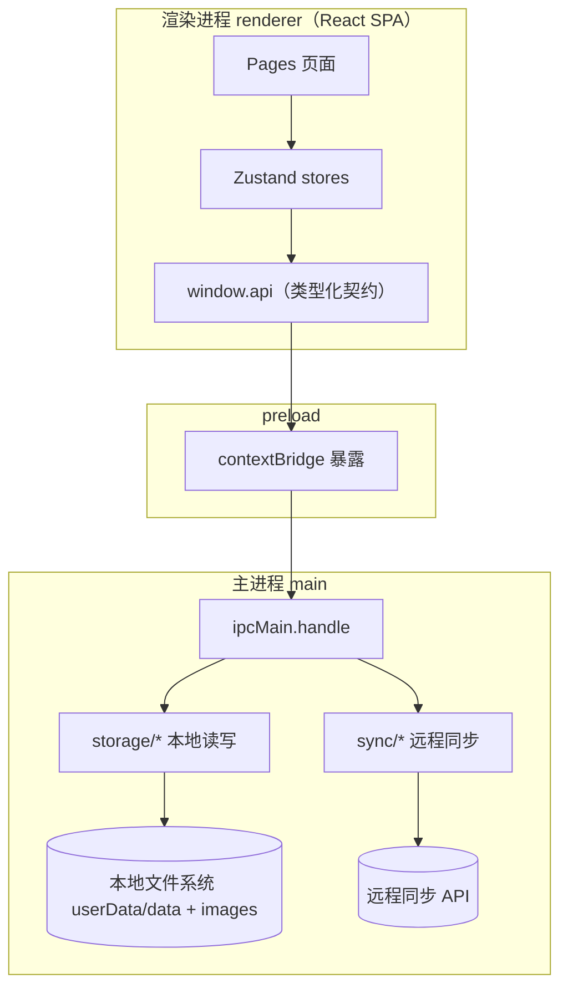

# DESIGN.md

本项目（`electron-learn-everything`）的设计与架构文档，以**当前代码为准**。日常操作类说明见 [`AGENTS.md`](./AGENTS.md)，分阶段实施计划见 [`plan.md`](./plan.md)。

## 1. 概述

- **定位**：Windows 11 风格的个人记录类桌面应用，管理三个领域——日记（富文本）、博客（Markdown）、开发项目（看板/任务/代码片段）。
- **形态**：Electron **三进程**桌面应用（`main` / `preload` / `renderer`），跨平台无边框窗口 + 自定义标题栏。
- **存储**：**本地优先**——一切数据先写本地文件系统（`userData`），远程同步为**手动触发**的增量同步（非实时、非自动）。
- **技术栈**：Electron 34 · electron-vite 3 · React 18 · TypeScript 5 · Tailwind CSS v4（`@theme` 设计 token）· shadcn/ui（new-york）· Zustand · Tiptap。

### 核心设计原则

1. **进程解耦**：渲染进程永不可直接访问 Node / 文件系统，所有副作用经主进程 IPC 完成。
2. **类型从源共享**：跨进程类型与频道常量集中在 `src/shared/types`，主进程与渲染进程只引用、不重复定义。
3. **本地优先**：本地文件是唯一事实源，同步是"把本地推到远端 / 把远端合并回本地"的增量过程，断网也能完整工作。
4. **主题化/可换肤**：UI 语义 token + 明暗变体 + 可切换的 scoped palette，整壳（侧栏/标题栏/卡片/编辑器）一套变量统一换肤。

## 2. 架构总览



| 进程 | 目录 | 职责 |
|------|------|------|
| main（主进程） | `src/main/` | 创建窗口、注册 IPC handler、本地文件读写（`storage/`）、同步（`sync/`） |
| preload | `src/preload/` | `contextBridge` 把 `window.api` / `window.electron` 暴露给渲染进程，`index.d.ts` 提供类型 |
| renderer（渲染进程） | `src/renderer/` | React 界面：`pages`（路由页）、`components`（`ui`/`layout`/`diary`…）、`stores`（Zustand）、`router`、`lib` |
| shared（共享） | `src/shared/types/` | 跨进程共享类型与 IPC 频道常量（`diary` / `sync` / `ipc`） |

**典型调用链**：`Pages → stores → window.api.<域>.<动作> → ipcRenderer.invoke → ipcMain.handle → storage/sync → 本地文件 / 远程 HTTP`。

## 3. 核心设计决策（ADR 摘要）

| 决策点 | 选择 | 理由 |
|--------|------|------|
| 状态管理 | **Zustand** | 轻量、少样板、可在组件外调用（适合 IPC 回写触发刷新） |
| 数据存储 | **本地文件（Markdown/JSON）** | 无需编译原生模块，数据透明可外部编辑，便于 Git 版本管理 |
| 日记编辑器 | **Tiptap**（ProseMirror） | 所见即所得，支持图片/任务列表/高亮，正文存 HTML |
| 跨进程契约 | **类型化 IPC** | 频道常量 + `window.api` 类型 + handler 三层，编译期校验 |
| 窗口方案 | `frame: false` + 自定义标题栏 | 跨平台统一无边框，替代 macOS-only 的 `titleBarStyle` |
| 删除语义 | **墓碑软删**（`deletedAt`） | 删除需随同步传播，不能物理消失 |
| 主题 | 语义 token + `@theme` + scoped palette | 明暗模式与"日记暖色手帐"等换肤都不改组件内部 |
| 路由 | `createBrowserRouter` + `React.lazy` + Suspense | 按页代码分割，编辑器等重组件首屏不阻塞 |

## 4. 数据模型与本地存储

### 4.1 日记条目（`src/shared/types/diary.ts`）

```ts
interface DiaryEntry {
  id: string
  title: string
  content: string        // Tiptap 生成的 HTML，是列表/详情/全文搜索的唯一数据源
  mood: string | null
  weather: string | null
  tags: string[]
  isFavorite: boolean
  wordCount: number
  createdAt: string      // ISO 8601
  updatedAt: string
  deletedAt: string | null // 墓碑：非空即已删除
}
```

### 4.2 磁盘布局（`app.getPath('userData')` 下）

```
data/
├── diary/{year}/{month}/{date}-{id}.json   # 每条日记一个 JSON 文件
│   └── index.json                          # { [date]: DiaryEntryMeta[] } 元数据索引
├── settings.json                           # 同步设置（syncBaseUrl / syncApiKey）
└── syncState.json                          # lastPushAt / lastPullAt / lastError
images/{uuid}.{ext}                         # 日记图片附件（返回 file:// 地址）
```

- **索引**：`index.json` 只存轻量元数据（`id/title/mood/weather/wordCount/createdAt/updatedAt/deletedAt`），列表/搜索/日历先读索引、按需加载单条文件。
- **归一化**：读入用 `normalizeEntry()` 补默认值，旧版本 JSON（缺 `deletedAt` 等）无需迁移即可兼容。

## 5. 同步设计（本地优先）

同步**手动触发**（`SyncToolbar` 的「上传 / 下载」按钮），本地文件永远是事实源，远程是可选副本。

- **方向**：双向，分别触发（push / pull 各自维护游标）。
- **粒度**：增量，游标用条目的 `updatedAt`（字符串比较，`>` 不含等号）。
- **冲突**：后写覆盖（`updatedAt` 新者胜）。
- **范围**：仅日记「正文 + 元数据」，**图片附件不在本版同步范围**（契约见 [`docs/diary-sync-api.md`](./docs/diary-sync-api.md)）。

### 5.1 push（上传）：`src/main/sync/diary.ts`

1. 快照游标 `now`，取 `listEntriesForSync(lastPushAt)` 中 `updatedAt <= now` 的脏条目（含墓碑），之后的新编辑滚入下一批。
2. `POST /entries/sync`（`Authorization: Bearer <apiKey>`），响应可为逐条结果 `{ results: [{ id, ok?, stale? }] }`。
3. 任何一条 `ok === false` → **整体抛错、游标不前进**，确保被拒条目（尤其墓碑）下次重试，删除不会静默丢失。
4. 计数 `stale`（服务端已有更新版本的跳过数），推进 `lastPushAt = now` 并落盘。

### 5.2 pull（下载）与合并

1. `GET /entries/changes?since=<lastPullAt>`，响应 `{ entries, serverTime? }`。
2. 对每条远端条目 `mergeRemote`：取本地同 `id`，远端更新 → 覆盖；本地新/相等 → 保留本地（等下次 push 回写远端）。
3. 墓碑规则：远端的未知 `deletedAt` 不"复活"本地（直接跳过）；远端墓碑比本地新 → 本地标记删除。
4. 新游标 = `max(各条 updatedAt/deletedAt, serverTime)`。

- **稳定性**：两个方向都对后端返回做了宽容解析（空 body / 异常 JSON），保证游标健壮、失败时 `lastError` 落盘并保留上一游标。

## 6. 前端状态与路由

### 6.1 Zustand stores（`src/renderer/src/stores/`）

| Store | 形态 | 职责 |
|-------|------|------|
| `syncStore` | **action 型** | 唯一含异步动作的 store：`push/pull/refresh` 调 `window.api.diary.*`，维护 `isPushing/isPulling/status` |
| `themeStore` | action 型 | `mode: light/dark/system` + `resolved`，`localStorage` 持久化并切换 `<html>` 的 `.dark/.light` |
| `diaryStore` | 数据型 | `entries/selectedDate/isLoading` + setters（页面组件直接调 `window.api.diary.*` 后回写） |
| `blogStore` / `projectStore` / `searchStore` | 数据型（占位） | 定义领域 shape + setters，尚未接入 IPC |
| `settingsStore` | 本地偏好 | `autoSave/editorFontSize/language`，**仅在内存**，未持久化（与主进程 `settings.json` 的同步设置有别） |

### 6.2 路由（`src/renderer/src/router/`）

- `routes.tsx` 定义 `AppRouteObject`（在 `RouteObject` 上扩展 `meta: { title?, requiresAuth?, permissions? }`），页面统一 `React.lazy`。
- `RouterProvider.tsx` 用 `createBrowserRouter` 渲染，外层 `Suspense + Loading`。
- 守卫：`RouteGuard`（组件式）与 `useRouteGuard`（Hook 式）当前均为**占位**（`isAuthenticated = true`），认证/权限逻辑待后续接入。

## 7. UI / 主题系统

- **设计 token**：`src/renderer/src/styles/index.css` 的 `@theme` 定义语义变量（`--color-accent`、`--color-surface-*`、`--radius-*`、`--shadow-*`、字体栈 Segoe UI Variable / SF Pro / Noto Serif SC 等）。
- **明暗**：`@custom-variant dark` + `.dark` 类切换；Acrylic / Mica 毛玻璃工具类、Windows 11 滚动条与 focus 样式内建。
- **scoped palette（可换肤）**：`lib/palette.ts` 提供 `PaletteId = 'default' | 'journal'`，`useRoutePalette` 按路由在 `useLayoutEffect` 给 `<html>` 设 `data-palette`，`index.css` 中的 `:root[data-palette='journal'] { … }` 统一覆盖语义 token——进入日记模块时整壳换成「温暖手帐」暖色调，组件自身不改一行。
- **日记编辑器**：Tiptap（StarterKit + Image + Placeholder + Underline + Link + TaskList/Item + CharacterCount + Highlight），BubbleMenu 工具条，`update` 事件 1600ms 防抖自动保存 + `Cmd/Ctrl+S` 手动保存；正文存 HTML，字数为 `CharacterCount` 统计。

## 8. IPC 设计

新增 IPC 频道三步（详见 [`AGENTS.md`](./AGENTS.md)）：

1. `src/shared/types/ipc.ts` 的 `IPC_CHANNELS` 加常量；
2. `src/preload/index.ts` 的 `api` 加方法 + `index.d.ts` 的 `WindowAPI` 加类型；
3. `src/main/ipc/<域>.ts` 注册 `ipcMain.handle` 并在 `ipc/index.ts` 聚合。

**现状缺口**：`window/app/file/shell` 已统一到共享 `IPC_CHANNELS`；`diary/settings/sync` 的频道常量仍分散在 `main/ipc/diary.ts`、`main/ipc/sync.ts` 的本地 `CHANNELS`，`preload` 中仍为硬编码字符串，改造时应顺手迁移。

## 9. 已知限制、风险与路线图

- **实施进度**：阶段 1（基础层）与阶段 2（日记）已完成；阶段 3（博客）、4（开发项目）、5（通用/打磨）未做（详见 `plan.md`）。
- **工程化缺口**：无测试基础设施（Vitest 未配置）、无 pre-commit 钩子（Husky）、未加 CSP。
- **类型一致性**：`diaryStore.ts` 内重复定义了缺少 `deletedAt` 的 `DiaryEntry`，与 `shared/types/diary.ts` 漂移，应统一引用共享类型。
- **文档时效**：`方案.md`（日记"图文卡片模板底座"）所列 `diaryHtml.ts`/`templates.ts`/`PhotoNoteEditor.tsx` 及 `DiaryEntry.type/blocks` **尚未落地**；`docs/diary-sync-client-plan.md` 开头的"尚未改代码"已过时（同步代码已实现）。
- **风险与应对**（摘自 `plan.md`）：文件量增长后搜索变慢 → 维护 `index.json` 缓存、超千条再考虑 SQLite；大图体积 → 主进程压缩（上限 1920px）；无边框跨平台差异 → `window.ts` 平台抽象；编辑器体积 → `React.lazy` 按需加载。
