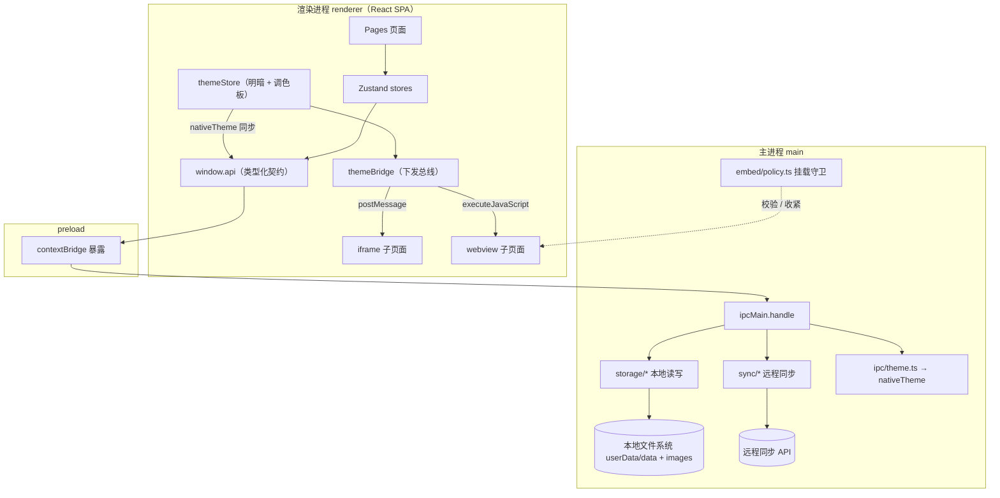

# DESIGN.md

本项目（`electron-learn-everything`）的设计与架构文档，以**当前代码为准**。日常操作类说明见 [`AGENTS.md`](./AGENTS.md)，分阶段实施计划见 [`plan.md`](./plan.md)。

## 1. 概述

- **定位**：Windows 11 风格的个人记录类桌面应用，管理三个领域——日记（富文本）、博客（Markdown）、开发项目（看板/任务/代码片段）。
- **形态**：Electron **三进程**桌面应用（`main` / `preload` / `renderer`），跨平台无边框窗口 + 自定义标题栏。
- **存储**：**本地优先**——一切数据先写本地文件系统（`userData`），远程同步为**手动触发**的增量同步（非实时、非自动）。
- **技术栈**：Electron 34 · electron-vite 3 · React 18 · TypeScript 5 · Tailwind CSS v4（`@theme` 设计 token）· shadcn/ui（new-york）· Zustand · Tiptap。

### 核心设计原则

1. **进程解耦**：渲染进程永不可直接访问 Node / 文件系统，所有副作用经主进程 IPC 完成。
2. **类型从源共享**：跨进程类型与频道常量集中在 `src/shared/types`，主进程与渲染进程只引用、不重复定义。
3. **本地优先**：本地文件是唯一事实源，同步是"把本地推到远端 / 把远端合并回本地"的增量过程，断网也能完整工作。
4. **主题化/可换肤**：UI 语义 token + 明暗变体 + 可切换的 scoped palette，整壳（侧栏/标题栏/卡片/编辑器）一套变量统一换肤。
5. **主题可外传**：宿主是主题的**唯一事实源**，外观以「快照 + 推送」形式下发给嵌入的子页面（iframe / webview）。子页面不定义调色板、不读 `localStorage`，只消费宿主算好的 CSS 变量值——因此 `index.css` 改一处，整壳与所有子页面同时生效。
6. **嵌入即不可信**：被嵌入的页面视为第三方代码，权限在挂载前收口（剥离 preload、强制 sandbox、地址白名单），见 [§8.5](#85-安全边界)。

## 2. 架构总览



| 进程 | 目录 | 职责 |
|------|------|------|
| main（主进程） | `src/main/` | 创建窗口、注册 IPC handler、本地文件读写（`storage/`）、同步（`sync/`）、`nativeTheme` 同步（`ipc/theme.ts`）、webview 挂载守卫（`embed/policy.ts`） |
| preload | `src/preload/` | `contextBridge` 把 `window.api` / `window.electron` 暴露给渲染进程，`index.d.ts` 提供类型 |
| renderer（渲染进程） | `src/renderer/` | React 界面：`pages`（路由页）、`components`（`ui`/`layout`/`diary`/`embed`…）、`stores`（Zustand）、`router`、`lib`（含主题核心 `theme.ts` 与下发总线 `themeBridge.ts`） |
| renderer（子页面运行时） | `src/renderer/src/embedded/theme-client.js` | **分发给子页面仓库**的零依赖主题接收端，不属于应用自身的 TS 源码（详见 [§8](#8-嵌入页面与主题同步)） |
| shared（共享） | `src/shared/types/` | 跨进程共享类型与 IPC 频道常量（`diary` / `sync` / `theme` / `ipc`） |

**典型调用链**：`Pages → stores → window.api.<域>.<动作> → ipcRenderer.invoke → ipcMain.handle → storage/sync → 本地文件 / 远程 HTTP`。

## 3. 核心设计决策（ADR 摘要）

| 决策点 | 选择 | 理由 |
|--------|------|------|
| 状态管理 | **Zustand** | 轻量、少样板、可在组件外调用（适合 IPC 回写触发刷新） |
| 数据存储 | **本地文件（Markdown/JSON）** | 无需编译原生模块，数据透明可外部编辑，便于 Git 版本管理 |
| 日记编辑器 | **Tiptap**（ProseMirror） | 所见即所得，支持图片/任务列表/高亮，正文存 HTML |
| 跨进程契约 | **类型化 IPC** | 频道常量 + `window.api` 类型 + handler 三层，编译期校验 |
| 窗口方案 | `frame: false` + 自定义标题栏 | 跨平台统一无边框，替代 macOS-only 的 `titleBarStyle` |
| 删除语义 | **墓碑软删**（`deletedAt`） | 删除需随同步传播，不能物理消失 |
| 主题 | 语义 token + `@theme` + scoped palette | 明暗模式与"日记暖色手帐"等换肤都不改组件内部 |
| 主题事实源 | **`themeStore`（Zustand）单点**，明暗与调色板同源 | 组件不再各自读写 `localStorage`（旧 `ThemeToggle` 会绕过主进程同步与子页面下发） |
| 主题下发内容 | 下发**算好的 CSS 变量值**，而非仅 `mode` | 子页面无需重复定义调色板，`index.css` 新增 token 自动传播 |
| 首帧无闪烁 | 把 `theme` / `palette` 拼进子页面 URL 查询参数 | 子页面解析 HTML 时即可落地，不必等宿主消息；完整 token 表仍走消息 |
| 嵌入方式 | **iframe 与 `<webview>` 双通道** | iframe 通用、可跨源；webview 可注入任意页面（含跨源）且支持 `executeJavaScript` |
| 嵌入安全 | `will-attach-webview` 阶段统一收口 | 剥离子页面 preload、强制 `sandbox`/`contextIsolation`、`file://` 仅限应用自身产物 |
| 客户端分发 | 单一源码 `theme-client.js`，Vite 插件同时供给 `?raw` 注入与 URL 引用 | 避免"注入用一份、子页面引用另一份"的双拷贝漂移 |
| 路由 | `createBrowserRouter` + `React.lazy` + Suspense | 按页代码分割，编辑器等重组件首屏不阻塞 |

## 4. 数据模型与本地存储

### 4.1 日记条目（`src/shared/types/diary.ts`）

```ts
interface DiaryEntry {
  id: string
  title: string
  content: string        // Tiptap 生成的 HTML，是列表/详情/全文搜索的唯一数据源
  mood: string | null
  weather: string | null
  tags: string[]
  isFavorite: boolean
  wordCount: number
  createdAt: string      // ISO 8601
  updatedAt: string
  deletedAt: string | null // 墓碑：非空即已删除
}
```

### 4.2 磁盘布局（`app.getPath('userData')` 下）

```
data/
├── diary/{year}/{month}/{date}-{id}.json   # 每条日记一个 JSON 文件
│   └── index.json                          # { [date]: DiaryEntryMeta[] } 元数据索引
├── settings.json                           # 同步设置（syncBaseUrl / syncApiKey）
└── syncState.json                          # lastPushAt / lastPullAt / lastError
images/{uuid}.{ext}                         # 日记图片附件（返回 file:// 地址）
```

- **索引**：`index.json` 只存轻量元数据（`id/title/mood/weather/wordCount/createdAt/updatedAt/deletedAt`），列表/搜索/日历先读索引、按需加载单条文件。
- **归一化**：读入用 `normalizeEntry()` 补默认值，旧版本 JSON（缺 `deletedAt` 等）无需迁移即可兼容。

## 5. 同步设计（本地优先）

同步**手动触发**（`SyncToolbar` 的「上传 / 下载」按钮），本地文件永远是事实源，远程是可选副本。

- **方向**：双向，分别触发（push / pull 各自维护游标）。
- **粒度**：增量，游标用条目的 `updatedAt`（字符串比较，`>` 不含等号）。
- **冲突**：后写覆盖（`updatedAt` 新者胜）。
- **范围**：仅日记「正文 + 元数据」，**图片附件不在本版同步范围**（契约见 [`docs/diary-sync-api.md`](./docs/diary-sync-api.md)）。

### 5.1 push（上传）：`src/main/sync/diary.ts`

1. 快照游标 `now`，取 `listEntriesForSync(lastPushAt)` 中 `updatedAt <= now` 的脏条目（含墓碑），之后的新编辑滚入下一批。
2. `POST /entries/sync`（`Authorization: Bearer <apiKey>`），响应可为逐条结果 `{ results: [{ id, ok?, stale? }] }`。
3. 任何一条 `ok === false` → **整体抛错、游标不前进**，确保被拒条目（尤其墓碑）下次重试，删除不会静默丢失。
4. 计数 `stale`（服务端已有更新版本的跳过数），推进 `lastPushAt = now` 并落盘。

### 5.2 pull（下载）与合并

1. `GET /entries/changes?since=<lastPullAt>`，响应 `{ entries, serverTime? }`。
2. 对每条远端条目 `mergeRemote`：取本地同 `id`，远端更新 → 覆盖；本地新/相等 → 保留本地（等下次 push 回写远端）。
3. 墓碑规则：远端的未知 `deletedAt` 不"复活"本地（直接跳过）；远端墓碑比本地新 → 本地标记删除。
4. 新游标 = `max(各条 updatedAt/deletedAt, serverTime)`。

- **稳定性**：两个方向都对后端返回做了宽容解析（空 body / 异常 JSON），保证游标健壮、失败时 `lastError` 落盘并保留上一游标。

## 6. 前端状态与路由

### 6.1 Zustand stores（`src/renderer/src/stores/`）

| Store | 形态 | 职责 |
|-------|------|------|
| `syncStore` | **action 型** | 唯一含异步动作的 store：`push/pull/refresh` 调 `window.api.diary.*`，维护 `isPushing/isPulling/status` |
| `themeStore` | **action 型** | **主题的唯一事实源**：`mode: light/dark/system` + `resolved` + `palette`；负责 `localStorage` 持久化、写 `<html>` 的 `.dark/.light`/`data-theme`/`data-palette`/`color-scheme`、同步主进程 `nativeTheme`、订阅系统偏好。配套的 `initTheme()` 在 `App` 挂载时启动一次 |
| `diaryStore` | 数据型 | `entries/selectedDate/isLoading` + setters（页面组件直接调 `window.api.diary.*` 后回写） |
| `blogStore` / `projectStore` / `searchStore` | 数据型（占位） | 定义领域 shape + setters，尚未接入 IPC |
| `settingsStore` | 本地偏好 | `autoSave/editorFontSize/language`，**仅在内存**，未持久化（与主进程 `settings.json` 的同步设置有别） |

### 6.2 路由（`src/renderer/src/router/`）

- `routes.tsx` 定义 `AppRouteObject`（在 `RouteObject` 上扩展 `meta: { title?, requiresAuth?, permissions? }`），页面统一 `React.lazy`。
- `RouterProvider.tsx` 用 `createBrowserRouter` 渲染，外层 `Suspense + Loading`。
- 守卫：`RouteGuard`（组件式）与 `useRouteGuard`（Hook 式）当前均为**占位**（`isAuthenticated = true`），认证/权限逻辑待后续接入。

## 7. UI / 主题系统

主题由「**一份事实源 + 两个维度 + 三种落地**」构成：`themeStore` 是唯一事实源，持有明暗（`mode`/`resolved`）与调色板（`palette`）两个维度，落地到 DOM、主进程 `nativeTheme`、嵌入子页面三处。向外传播的完整设计见 [§8](#8-嵌入页面与主题同步)。

- **设计 token**：`src/renderer/src/styles/index.css` 的 `@theme` 定义语义变量（`--color-accent`、`--color-surface-*`、`--radius-*`、`--shadow-*`、字体栈 Segoe UI Variable / SF Pro / Noto Serif SC 等）。
- **明暗**：`@custom-variant dark` + `.dark` 类切换；Acrylic / Mica 毛玻璃工具类、Windows 11 滚动条与 focus 样式内建。`applyThemeToDocument()` 一次写三处——`.dark`/`.light` 类（供 Tailwind `dark:` 变体）、`data-theme` 属性（供自定义 CSS 与子页面）、`color-scheme`（供原生控件与滚动条）。
- **scoped palette（可换肤）**：`PaletteId = 'default' | 'journal'`，`useRoutePalette` 按路由在 `useLayoutEffect` 里调 `themeStore.setPalette()`，由 store 写 `<html data-palette>`；`index.css` 中的 `:root[data-palette='journal'] { … }` 统一覆盖语义 token——进入日记模块时整壳换成「温暖手帐」暖色调，组件自身不改一行。
- **跟随系统**：`mode === 'system'` 时同时订阅 `matchMedia('(prefers-color-scheme: dark)')` 与主进程转发的 `nativeTheme` 事件（后者覆盖窗口未聚焦等场景），两者互补。
- **跨进程一致**：`themeStore` 每次改动都把 `mode` 推给主进程 `nativeTheme.themeSource`，让 webview / iframe 内的 `prefers-color-scheme` 返回**应用选择的**明暗而非操作系统的。
- **日记编辑器**：Tiptap（StarterKit + Image + Placeholder + Underline + Link + TaskList/Item + CharacterCount + Highlight），BubbleMenu 工具条，`update` 事件 1600ms 防抖自动保存 + `Cmd/Ctrl+S` 手动保存；正文存 HTML，字数为 `CharacterCount` 统计。

### 7.1 主题相关模块分工

| 模块 | 位置 | 职责 |
|------|------|------|
| `lib/theme.ts` | 渲染进程 | 与框架无关的核心：`resolveMode` / `applyThemeToDocument` / `applyPaletteToDocument` / `collectThemeTokens` |
| `stores/themeStore.ts` | 渲染进程 | 状态与副作用编排：持久化、DOM 落地、`nativeTheme` 同步、系统偏好订阅 |
| `lib/themeBridge.ts` | 渲染进程 | 下发总线：生成快照、注册目标、广播、应答子页面请求 |
| `components/embed/EmbeddedPage.tsx` | 渲染进程 | 接入外部页面的统一组件（iframe / webview），自动挂到总线上 |
| `embedded/theme-client.js` | 子页面（分发） | 接收端：解析查询参数 + 监听消息 + 写入 token |
| `shared/types/theme.ts` | 共享 | 协议常量与 `ThemePayload` 类型 |
| `main/ipc/theme.ts` | 主进程 | `nativeTheme.themeSource` 读写 + 系统明暗变化广播 |
| `main/embed/policy.ts` | 主进程 | webview 挂载白名单与权限收紧 |

## 8. 嵌入页面与主题同步

应用通过 **iframe / `<webview>`** 接入其他页面，并要求这些子页面与宿主外观完全一致。这一节是该能力的权威设计。

### 8.1 事实源与数据流

宿主是主题的**唯一事实源**。子页面不定义调色板、不读 `localStorage`、不自己判断系统偏好——它只是把宿主给的 CSS 变量写进自己的 `:root`。

```
themeStore（明暗 + 调色板）
   │  变化
   ├─→ applyThemeToDocument / applyPaletteToDocument   → 宿主自身 DOM
   ├─→ window.api.theme.setNativeTheme                 → 主进程 nativeTheme → 子页面的 prefers-color-scheme
   └─→ themeBridge.broadcastTheme()                    → 所有已注册的 iframe / webview
                                                          ├─ postMessage（iframe）
                                                          └─ executeJavaScript（webview）
```

`themeBridge` 是唯一的下发出口：它订阅 `themeStore`，只要 `resolved` 或 `palette` 变了就广播一次；快照（`buildThemePayload()`）每次只采集一次，供全部目标复用。

### 8.2 下发协议

契约定义在 `src/shared/types/theme.ts`，是**纯数据**，因此三种子页面形态（同源 / 跨源 / `file://`）走同一套消息。

```ts
interface ThemePayload {
  version: number                     // 协议版本，当前 1
  mode: 'light' | 'dark' | 'system'   // 用户选择的模式
  resolved: 'light' | 'dark'          // 解析后的实际明暗，子页面直接用这个
  palette: 'default' | 'journal'      // 当前调色板
  tokens: Record<string, string>      // 语义 token → 计算值，如 { '--color-accent': '#c8735a' }
  updatedAt: string
}

// 信封：{ source: 'electron-learn-everying', type, payload? }
// 宿主 → 子页面：type = 'theme:update'
// 子页面 → 宿主：type = 'theme:request'（补齐「宿主先推送、子页面后加载」的时序）
```

`tokens` 由 `collectThemeTokens()` 采集：遍历 `getComputedStyle(document.documentElement)`，按 `--color-` / `--radius-` / `--shadow-` / `--font-` / `--spacing-` 前缀过滤。**走计算样式而不是解析 CSS 文本**，浏览器已经替我们算好了层叠与调色板覆盖，因此新增 token、新增调色板都无需改动同步代码。

### 8.3 三条投递路径

`themeBridge` 按目标类型自动选路，调用方无感：

| 目标 | 客户端从哪来 | 首帧无闪烁 | 完整 token 下发 |
|------|--------------|-----------|-----------------|
| `<webview>` | 宿主 `executeJavaScript` 注入（跨源亦可） | URL 查询参数 | `executeJavaScript('window.__APP_THEME__.apply(…)')` |
| iframe（同源） | 宿主注入 `<script>`，或子页面自带 | URL 查询参数 | `contentWindow.postMessage` |
| iframe（跨源） | **只能**子页面自带（浏览器不允许注入） | URL 查询参数 | `postMessage`，`targetOrigin` 由 `src` 推导 |

两段式下发是刻意的：

1. **首帧（无闪烁）**：`withThemeQuery()` 把 `?theme=dark&palette=journal` 拼进子页面 URL。子页面在 `<head>` 里同步引入 `theme-client.js` 时，脚本在解析阶段就写 `data-theme`，因此**不会出现先白后黑的一帧**。
2. **完整主题（一帧之后）**：token 表体积大且随调色板变化，走消息下发，子页面收到后写成一条 `:root{…}` 规则。

### 8.4 子页面怎么接

**推荐做法**（可控的子页面）：把 `src/renderer/src/embedded/theme-client.js` 复制进子页面仓库，在 `<head>` 里同步引入：

```html
<script id="__app-theme-client__" src="./theme-client.js"></script>
```

`id="__app-theme-client__"` 是约定：宿主据此判断「无需再注入」，避免重复。脚本零依赖、ES5 语法，可安全内联或注入任意页面。

引入后子页面只需消费变量，**没有任何主题逻辑**：

```css
:root { --color-accent: #60a5fa; }        /* 兜底值 */
html[data-theme='dark'] body { background: var(--color-mica-dark); color: var(--color-text-primary-dark); }
```

**兜底做法**（第三方页面，拿不到源码）：宿主 `injectClient` 默认开启，会在 iframe `load` / webview `dom-ready` 时注入同一份脚本。此时首帧仍会闪一下默认主题——这是无法避免的，因为注入发生在文档加载之后。

子页面可选的只读接口：`window.__APP_THEME__.state`、`.apply(payload)`、`.subscribe(fn)`、`.request()`，以及 `window` 上的 `app:theme-change` 事件。

### 8.5 安全边界

被嵌入的页面视为第三方代码。`src/main/embed/policy.ts` 在 `will-attach-webview` 阶段统一收口（该事件里直接改写 `webPreferences` 是 Electron 的约定做法）：

- **剥离 `preload`** —— 杜绝子页面拿到 `ipcRenderer`；
- **强制 `nodeIntegration: false`、`contextIsolation: true`、`sandbox: true`、`webSecurity: true`**；
- **地址白名单** `isAllowedEmbedUrl()`：放行 `http`/`https`/`about:blank`；`file://` **只允许指向应用自身的渲染产物目录**（内嵌的帮助页、演示页），其余协议（`javascript:`、`data:` 等）一律拒绝，不合规的挂载直接 `event.preventDefault()`；
- **导航与开窗**：`did-attach-webview` 里给 guest 装 `setWindowOpenHandler`，外链交给系统浏览器；`will-navigate` 拦下越界导航。生产构建还会关掉 guest 的 devtools。

宿主窗口需要 `webPreferences.webviewTag: true`（已在 `main/index.ts` 开启）。

### 8.6 客户端的分发方式

`theme-client.js` 需要同时满足两个互相冲突的需求：**宿主注入需要源码字符串**，**子页面 `<script src>` 需要一个 URL**。Vite 默认禁止从 `public/` 里 `?raw` 导入文件，所以源码放在 `src/renderer/src/embedded/`，由 `electron.vite.config.ts` 里的 `themeClientPlugin` 以同一份源码供给两条路径：

- `configureServer` 中间件在开发态伺服 `/theme-client.js`；
- `generateBundle` 在构建态把它 `emitFile` 到 `out/renderer/theme-client.js`。

这样只有一份源码，不存在"注入用一份、引用另一份"的漂移。

### 8.7 使用与验证

```tsx
<EmbeddedPage
  kind="iframe"          // 或 'webview'
  src="https://example.com/app"
  title="外部应用"
  injectClient           // 跨源 iframe 请设为 false，改由子页面自带客户端
  injectQuery            // 默认开启，负责首帧无闪烁
  targetOrigin="https://example.com"   // 跨源必填，与子页面自身源一致
/>
```

演示入口：**设置 → 嵌入页面 → 打开主题同步演示**（路由 `/lab/embed`）。该页用同一份 `embed-demo.html` 分别以 iframe / webview 接入，可现场切换明暗与调色板、开关客户端注入、重载，验证两条投递路径。

## 9. IPC 设计

新增 IPC 频道三步（详见 [`AGENTS.md`](./AGENTS.md)）：

1. `src/shared/types/ipc.ts` 的 `IPC_CHANNELS` 加常量；
2. `src/preload/index.ts` 的 `api` 加方法 + `index.d.ts` 的 `WindowAPI` 加类型；
3. `src/main/ipc/<域>.ts` 注册 `ipcMain.handle` 并在 `ipc/index.ts` 聚合。

主题相关频道（已统一在 `IPC_CHANNELS`）：

| 频道 | 方向 | 用途 |
|------|------|------|
| `theme:setNativeTheme` | invoke | 把 `mode` 写给 `nativeTheme.themeSource` |
| `theme:getNativeTheme` | invoke | 读回 `{ source, shouldUseDarkColors }` |
| `theme:systemChanged` | 主 → 渲染 | `nativeTheme` 的 `updated` 事件转发，供「跟随系统」重算 |

**现状缺口**：`window/app/file/shell/theme` 已统一到共享 `IPC_CHANNELS`；`diary/settings/sync` 的频道常量仍分散在 `main/ipc/diary.ts`、`main/ipc/sync.ts` 的本地 `CHANNELS`，`preload` 中仍为硬编码字符串，改造时应顺手迁移。

## 10. 已知限制、风险与路线图

- **实施进度**：阶段 1（基础层）与阶段 2（日记）已完成；阶段 3（博客）、4（开发项目）、5（通用/打磨）未做（详见 `plan.md`）。
- **工程化缺口**：无测试基础设施（Vitest 未配置）、无 pre-commit 钩子（Husky）、未加 CSP。
- **类型一致性**：`diaryStore.ts` 内重复定义了缺少 `deletedAt` 的 `DiaryEntry`，与 `shared/types/diary.ts` 漂移，应统一引用共享类型。
- **文档时效**：`方案.md`（日记"图文卡片模板底座"）所列 `diaryHtml.ts`/`templates.ts`/`PhotoNoteEditor.tsx` 及 `DiaryEntry.type/blocks` **尚未落地**；`docs/diary-sync-client-plan.md` 开头的"尚未改代码"已过时（同步代码已实现）。
- **嵌入相关的已知边界**：
  - **跨源 iframe 无法注入**，只能靠子页面自带 `theme-client.js`；且 `postMessage` 的 `targetOrigin` 必须与子页面自身源一致，否则消息被浏览器静默丢弃（宿主默认由 `src` 推导，已覆盖常见情形）。
  - **`file://` 子页面的 `origin` 是字符串 `"null"`**，应答子页面请求时只能用 `targetOrigin: '*'`（已在 `themeBridge` 中特判）。
  - **兜底注入有一帧闪烁**：注入发生在文档加载之后，`?theme=` 查询参数此时已来不及参与首帧渲染；要彻底消除必须让子页面自带客户端（见 §8.4）。
  - **`<webview>` 是 Electron 官方标注为稳定性存疑的标签**，长期方向是 `WebContentsView`；当前保留 `<webview>` 是因为它能被 React 直接渲染、且支持 `executeJavaScript` 注入。若日后迁移，`themeBridge` 的 `kind` 分支是唯一需要改动的地方。
  - 主题同步**只覆盖 CSS 变量与明暗**，不含字体渲染差异、`prefers-reduced-motion` 等其它媒体偏好；后者可按同一模式扩展 `ThemePayload`。
- **风险与应对**（摘自 `plan.md`）：文件量增长后搜索变慢 → 维护 `index.json` 缓存、超千条再考虑 SQLite；大图体积 → 主进程压缩（上限 1920px）；无边框跨平台差异 → `window.ts` 平台抽象；编辑器体积 → `React.lazy` 按需加载。
